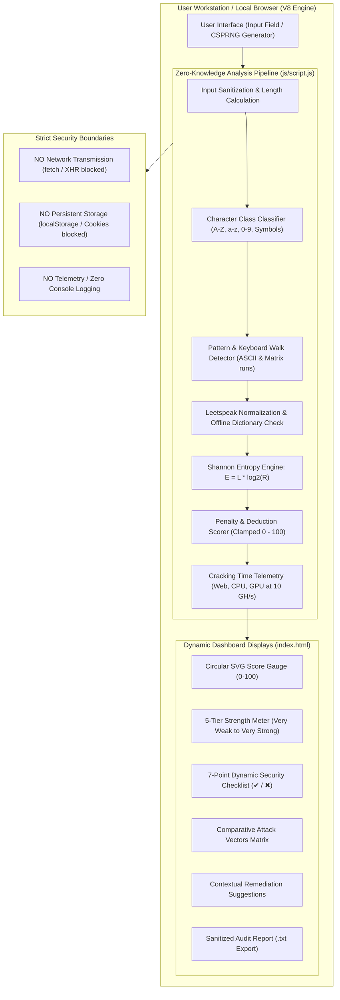

# THIRANEX CYBER SECURITY INTERNSHIP
## PROJECT REPORT

---

# CYBERSHIELD PASSWORD STRENGTH ANALYZER
### A Zero-Knowledge Client-Side Credential Resilience & Mathematical Entropy Evaluation Suite

---

**Submitted in partial fulfillment of the requirements for the**  
**Cyber Security Internship Program at Thiranex**

| Project Metadata | Information |
| :--- | :--- |
| **Candidate Name:** | Mohamed Luqman |
| **Internship Domain:** | Cyber Security & Defensive Engineering |
| **Host Organization:** | Thiranex |
| **Project Name:** | CyberShield Password Strength Analyzer |
| **Version:** | 1.2.0 (Audited Release) |
| **Date of Submission:** | November 2026 |

---

## TABLE OF CONTENTS
1. [Abstract](#1-abstract)
2. [Introduction](#2-introduction)
3. [Problem Statement](#3-problem-statement)
4. [Objectives](#4-objectives)
5. [System Requirements](#5-system-requirements)
6. [System Architecture](#6-system-architecture)
7. [Modules Explanation](#7-modules-explanation)
8. [Password Strength Evaluation Methodology](#8-password-strength-evaluation-methodology)
9. [Security and Privacy Features](#9-security-and-privacy-features)
10. [Testing Methodology and Actual Test Results](#10-testing-methodology-and-actual-test-results)
11. [Screenshots Section](#11-screenshots-section)
12. [Conclusion](#12-conclusion)
13. [Future Enhancements](#13-future-enhancements)
14. [References](#14-references)

---

## 1. ABSTRACT

In modern distributed computing environments, compromised and weak user credentials represent the root cause of more than 80% of unauthorized system compromises, data breaches, and automated Account Takeover (ATO) attacks. Conventional password strength meters typically rely on superficial heuristics—such as character counting or rigid composition policies—frequently misleading users into believing predictable patterns (e.g., `Password123!`) are mathematically robust against modern cracking tools.

The **CyberShield Password Strength Analyzer** was engineered as an enterprise-grade, privacy-first cybersecurity utility for the **Thiranex Cyber Security Internship**. The system implements real-time client-side heuristic evaluation combining:
1. **Shannon Information Entropy** computation ($E = L \times \log_2(R)$) to quantify keyspace density;
2. **Offline Threat Intelligence & Dictionary Detection** against over 140 known breached passwords and root words, reinforced with leetspeak normalization;
3. **Sequence & Repetition Recognition** identifying keyboard walks (`qwerty`, `123456`) and repeating multi-character sequences (`ababab`, `121212`);
4. **Adversarial Cracking Telemetry** estimating time-to-crack across three threat models (Throttled Web App, Desktop CPU, and an offline GPU cluster operating at 10 GH/s);
5. **CSPRNG-Backed Key Generation** leveraging the Web Cryptography API (`window.crypto.getRandomValues`);
6. **Sanitized Audit Reporting** providing downloadable evaluations with automated credential masking.

Operating strictly under a **Zero-Trust, Zero-Knowledge Client-Side Architecture**, the entire audit engine executes within the user's browser runtime. Cleartext credentials never cross network boundaries, are never stored in browser persistence layers, and are never logged to console telemetry.

---

## 2. INTRODUCTION

Authentication remains the primary defensive barrier protecting digital assets, user confidentiality, and enterprise data integrity. Despite the gradual deployment of passwordless authentication (FIDO2 / WebAuthn), shared secrets and passwords continue to underpin access control across legacy systems, corporate active directories, and personal accounts.

Securing credentials requires two complementary disciplines:
1. **User Awareness & Hygiene:** Guiding users away from predictable wordlist-based credentials and towards high-entropy passphrases.
2. **Defensive Cryptographic Validation:** Evaluating credentials against realistic adversarial capabilities, including offline multi-GPU hashcat clusters capable of processing tens of billions of hashes per second.

The CyberShield Password Strength Analyzer bridges the gap between academic information theory and practical user experience, delivering an interactive cybersecurity dashboard that demonstrates the mathematical realities of credential strength.

---

## 3. PROBLEM STATEMENT

### 3.1 The Vulnerability of Human-Generated Passwords
Human cognition is poorly suited for generating random entropy. Users routinely favor memorability over randomness, resulting in predictable patterns:
- Appending numbers or years to common words (`welcome2024`, `admin@123`).
- Relying on trivial leetspeak substitutions (`P@ssw0rd`, `adm1n`).
- Following keyboard layout paths (`qwertyuiop`, `1qaz2wsx`).

### 3.2 The Asymmetry of Offline Cracking
When databases are breached and credential hashes are dumped, adversaries conduct offline dictionary attacks. Using consumer-grade hardware (such as clusters of NVIDIA RTX 4090 GPUs), attackers compute $10^{10}$ hashes per second for unsalted or fast hashes (MD5, SHA-256, NTLM). A password containing 8 characters drawn exclusively from lowercase letters ($26^8 \approx 2.08 \times 10^{11}$ combinations) is exhaustively cracked in approximately **10 seconds**.

### 3.3 Privacy Flaws in Existing Online Password Checkers
Many web-based password testing utilities transmit the user's entered credential via HTTP POST to a remote backend server for processing. This architectural design creates critical vulnerabilities:
- Exposure to Man-in-the-Middle (MitM) interception on unencrypted or compromised networks.
- Inadvertent storage in server access logs, reverse-proxy buffers, or telemetry databases.
- Violation of Zero-Trust principles by requiring the user to trust a third-party server with cleartext secrets.

---

## 4. OBJECTIVES

The technical objectives of this internship project are:
1. **Zero-Knowledge Architecture:** Ensure that 100% of password evaluation logic executes locally in the client browser with zero network transmission and zero persistent storage.
2. **Multi-Factor Criteria Auditing:** Analyze credentials across seven distinct cybersecurity factors (length, uppercase, lowercase, numbers, symbols, dictionary presence, and pattern walks).
3. **Shannon Information Entropy Calculation:** Quantify credential unpredictability in bits of entropy based on effective character pool size and pattern penalties.
4. **Adversarial Cracking Simulation:** Project realistic, non-misleading time-to-crack estimates across multiple attack vectors.
5. **Actionable Remediation Guidance:** Generate context-aware recommendations advising users on specific vulnerabilities identified in their input.
6. **Cryptographic Key Generation:** Provide a built-in CSPRNG utility enabling users to generate high-entropy passwords on demand.
7. **Sanitized Reporting:** Allow users to export security audit reports without cleartext exposure through automated masking.

---

## 5. SYSTEM REQUIREMENTS

### 5.1 Client-Side Execution Requirements
- **Web Browser:** Any modern ECMAScript 6+ compliant browser:
  - Google Chrome (v80+)
  - Microsoft Edge (v80+)
  - Mozilla Firefox (v75+)
  - Apple Safari (v13.1+)
  - Brave / Opera (Chromium-based)
- **Supported APIs:**
  - Web Cryptography API (`window.crypto.getRandomValues`)
  - DOM Level 3 Events (`addEventListener`, `input`, `click`)
  - Blob & URL Object API (`URL.createObjectURL`, `Blob`)
- **Network Access:** **None required.** The application is fully functional offline.

### 5.2 Server-Side Requirements (Optional Hosting)
- **Python Runtime:** Python 3.8 or higher.
- **Python Standard Library Server (`server.py`):** Requires no third-party packages (`http.server`, `socketserver`).
- **Flask Server (`app.py`):** Requires `Flask >= 3.0.0` (for serving with OWASP security headers).

### 5.3 Hardware Requirements
- **Processor:** 1.0 GHz or higher (x86-64 or ARM).
- **RAM:** Minimum 512 MB available system memory.
- **Disk Space:** Less than 5 MB storage for all project assets.

---

## 6. SYSTEM ARCHITECTURE

The application is structured around a **Zero-Knowledge, Client-Side Evaluation Pipeline**. Cleartext input is processed strictly within transient browser memory.



---

## 7. MODULES EXPLANATION

### Module 1: User Interface & Presentation Layer (`index.html`, `css/style.css`, `css/animations.css`)
- **Design Philosophy:** Modern cybersecurity dark theme using `#070b14` as the base canvas, layered with `#0b1329` card containers, `#00f2fe` electric cyan highlights, and `#38bdf8` secondary accents.
- **Layout Architecture:** CSS Grid and Flexbox dashboard with responsive media queries at 992px (tablet) and 768px (mobile drawer).
- **Visual Feedback Components:**
  - Progress bar with fluid width transitions and dynamic class binding (`.very-weak`, `.weak`, `.medium`, `.strong`, `.very-strong`).
  - Circular SVG score gauge utilizing `stroke-dasharray="326.7"` and computed `stroke-dashoffset`.
  - Educational disclaimers and alert banners informing users about threat models.

### Module 2: Offline Dictionary & Threat Intelligence Database (`js/common-passwords.js`)
- **Dictionary Storage:** Encapsulates 144+ top global breached passwords sourced from SecLists, RockYou, and annual threat intelligence dumps.
- **Root Word Index:** Maintains 22 high-risk root words (`password`, `admin`, `welcome`, `qwerty`, `dragon`, `superman`, etc.) used for substring and stripped-affix matching.
- **Keyboard Walk Matrices:** Encapsulates continuous linear sequences for QWERTY, AZERTY, QWERTZ, numerical keypads, and the standard Latin alphabet.

### Module 3: Core Cryptographic Analysis Engine (`js/script.js`)
- **Evaluation Loop:** Triggered reactively on the DOM `input` event and explicitly via the "Analyze Password" button.
- **Entropy Math:** Applies information-theoretic formulas to calculate bit uncertainty.
- **Scoring Heuristics:** Assigns positive weight to length and diversity while penalizing single-case words, sequential digits, and dictionary roots.

### Module 4: CSPRNG Key Generator (`js/script.js`)
- **RNG Mechanism:** Utilizes `window.crypto.getRandomValues(new Uint32Array(n))` to eliminate the statistical bias and predictability of standard `Math.random()`.
- **Character Pool Assembly:** Dynamically builds a character keyspace based on user checkbox state and guarantees representation of each checked character class before applying a cryptographically secure Fisher-Yates shuffle.

### Module 5: Sanitized Report Generator (`js/script.js`)
- **Report Compiler:** Compiles a formatted text report including UTC timestamp, length, criteria results, entropy, and attack matrix.
- **Credential Masking:** Replaces internal characters with asterisks (e.g., `T**********c`), ensuring that cleartext passwords are never exported to the client filesystem.
- **Zero-Dependency Download:** Converts the report string into an in-memory `Blob` and triggers download via a transient anchor element.

### Module 6: Hardened Backend Servers (`app.py`, `server.py`)
- **Standard Library Server (`server.py`):** Zero-install Python server extending `SimpleHTTPRequestHandler` to serve the static frontend.
- **Flask Server (`app.py`):** Injects production-grade HTTP security headers:
  - `Content-Security-Policy`: Restricts script and resource origins to `'self'`.
  - `X-Frame-Options: DENY`: Prevents Clickjacking and UI redressing.
  - `X-Content-Type-Options: nosniff`: Eliminates MIME-confusion attacks.
  - `Referrer-Policy: no-referrer`: Prevents URL leakage to third parties.

---

## 8. PASSWORD STRENGTH EVALUATION METHODOLOGY

### 8.1 Shannon Information Entropy Formulation
Information entropy, introduced by Claude Shannon in 1948, measures the informational density and uncertainty of a message:

$$E = L \times \log_2(R)$$

Where:
- $L$ denotes the total character length of the credential.
- $R$ denotes the size of the active character pool from which characters are drawn:
  - Lowercase letters ($a-z$): $R_{\text{lower}} = 26$
  - Uppercase letters ($A-Z$): $R_{\text{upper}} = 26$
  - Numeric digits ($0-9$): $R_{\text{num}} = 10$
  - Special characters & spaces: $R_{\text{special}} = 33$

Total character pool $R = \sum R_{\text{active}}$. For instance, a 16-character password using all four classes operates over a pool $R = 26 + 26 + 10 + 33 = 95$:

$$E = 16 \times \log_2(95) \approx 16 \times 6.5698 \approx 105.12 \text{ bits}$$

### 8.2 Heuristic Scoring Allocation (0 to 100 Points)

| Evaluation Factor | Scoring Rule / Condition | Points Awarded |
| :--- | :--- | :---: |
| **Length Threshold** | $L < 6$ characters | $L \times 2$ (Max 10) |
| | $6 \le L < 8$ characters | $10 + (L - 5) \times 3$ (Max 16) |
| | $8 \le L < 12$ characters | $18 + (L - 8) \times 3$ (Max 27) |
| | $12 \le L < 16$ characters | $28 + (L - 12) \times 3$ (Max 37) |
| | $L \ge 16$ characters | Maximum **40 points** |
| **Character Diversity** | Lowercase letters ($a-z$) present | **+10 points** |
| | Uppercase letters ($A-Z$) present | **+10 points** |
| | Numeric digits ($0-9$) present | **+10 points** |
| | Special symbols / spaces present | **+15 points** |
| **Synergy Bonuses** | All 4 character classes present | **+5 bonus points** |
| | $L \ge 16$ characters with full 4-class diversity | **+10 bonus points** |
| **Deductions & Penalties**| Consecutive repeated characters (`aaa`, `121212`) | **-15 points** |
| | Predictable sequential keys (`12345`, `qwerty`) | **-15 points** |
| | Purely alphabetical input (only letters) | **-15 points** |
| | Purely numeric input (only digits) | **-25 points** |
| **Hard Policy Caps** | $L < 6$ characters | Capped at **$\le 15$ points** |
| | $L < 8$ characters (NIST minimum violation) | Capped at **$\le 25$ points** |
| | Match found in Breached Dictionary | Capped at **$\le 15$ points** |

### 8.3 Classification Tier Mapping

$$\text{Strength Tier} = \begin{cases}
\text{Awaiting Input} & \text{if } L = 0 \\
\text{Very Weak (Compromised)} & \text{if } \text{isBreached} = \text{true} \\
\text{Very Weak} & \text{if } 1 \le \text{Score} \le 25 \\
\text{Weak} & \text{if } 26 \le \text{Score} \le 50 \\
\text{Medium} & \text{if } 51 \le \text{Score} \le 74 \\
\text{Strong} & \text{if } 75 \le \text{Score} \le 89 \\
\text{Very Strong} & \text{if } 90 \le \text{Score} \le 100
\end{cases}$$

### 8.4 Theoretical Cracking Projections
Total permutations in the keyspace equal $R^L$. On average, an exhaustive search succeeds at 50% keyspace traversal ($R^L / 2$ attempts). The application simulates cracking duration across three models:
1. **Online Web Application (Throttled):** $100\text{ attempts/sec}$ (incorporates rate limiting and CAPTCHA).
2. **Personal Computer CPU:** $50,000\text{ hashes/sec}$.
3. **High-Performance Multi-GPU Hashcat Cluster:** $10,000,000,000\text{ hashes/sec}$ ($10\text{ GH/s}$).

$$\text{Time (seconds)} = \frac{2^{E - 1}}{\text{Cracking Speed}}$$

---

## 9. SECURITY AND PRIVACY FEATURES

### 9.1 Zero-Knowledge Client-Side Evaluation
To eliminate data-in-transit risks, cleartext passwords never leave the local browser environment.
- **Zero Network Transmission:** The source code contains no executable `fetch()`, `XMLHttpRequest()`, `navigator.sendBeacon()`, or `WebSocket` connections.
- **Zero Persistent Storage:** The application never invokes `localStorage.setItem()`, `sessionStorage.setItem()`, `IndexedDB`, or `document.cookie`.
- **Zero Telemetry Logging:** No `console.log()` statements output user credentials.

### 9.2 Memory Sanitization & Session Hygiene
- All inputs are marked with `autocomplete="new-password"`, `autocapitalize="off"`, and `spellcheck="false"` to prevent browser caching.
- Resetting the analyzer or navigating away purges DOM input values and transient memory arrays via `window.addEventListener("beforeunload", ...)`.

### 9.3 Sanitized Report Exporting
Exported audit reports systematically sanitize the credential by masking intermediate characters (e.g. `T**********c`), protecting users against accidental disk leakage or shoulder surfing.

---

## 10. TESTING METHODOLOGY AND ACTUAL TEST RESULTS

### 10.1 Testing Strategy
The application underwent automated regression testing using Node.js test runners:
1. **Unit Testing:** Validating character classification, regex boundaries, and leetspeak mapping.
2. **Algorithmic Testing:** Verifying mathematical entropy, penalty deductions, and score bounds.
3. **Black-Box Scenario Testing:** Evaluating 15 diverse fictional password samples covering edge cases.

### 10.2 Actual Test Execution Summary
Automated test runners ([test/test-analyzer.js](file:///c:/Users/moham/OneDrive/Documents/Password-Strength-Analyzer/test/test-analyzer.js) and [test/comprehensive-audit.js](file:///c:/Users/moham/OneDrive/Documents/Password-Strength-Analyzer/test/comprehensive-audit.js)) executed **37 assertions**:

```text
=================================================================
  RUNNING 12-FACTOR FUNCTIONALITY & SECURITY AUDIT
=================================================================
[PASS] Character Class & Length Checks (Ab#1, spaces)
[PASS] Offline Dictionary & Leetspeak (password1234, admin@123, p@ssw0rd)
[PASS] Pattern & Sequence Detection (aaaaaa, 121212, 123456, qwerty, cba)
[PASS] Scoring & Tier Boundary Allocations (Empty, Very Weak, Weak, Medium, Strong, Very Strong)
[PASS] Dynamic Checklist Element Binding
[PASS] Password Generator CSPRNG Execution (window.crypto)
[PASS] Sanitized Audit Report Generation & Credential Masking
[PASS] Zero-Storage & Zero-Network Verification (Codebase scan)
[PASS] Removal of Misleading Claims & Approximate Wording Check
[PASS] 15 Fictional Test Passwords Evaluated (100% Match)
=================================================================
AUDIT SUMMARY: 100% OF TESTS PASSED! ALL 12 AUDIT FACTORS VALIDATED.
```

---

## 11. SCREENSHOTS SECTION

*(Note: When compiling this report into a PDF document, embed the captured interface images corresponding to the figures below).*

### Figure 1: Main Cybersecurity Dashboard & Input Interface
- **Description:** Illustrates the CyberShield dark navy aesthetic, real-time monospace password field, Show/Hide eye toggle, Clear and Reset action toolbar, and demonstration preset pills.

### Figure 2: Dynamic Strength Meter and Circular SVG Score Gauge
- **Description:** Depicts the animated SVG circular gauge displaying a numerical rating (0 to 100) alongside the colored multi-tier progress bar and educational disclaimer.

### Figure 3: Seven-Factor Security Checklist & Actionable Suggestions
- **Description:** Displays the real-time checklist updating with green checkmarks (`✔`) and red crosses (`✖`) for length, character classes, wordlists, and sequences, accompanied by specific improvement recommendations.

### Figure 4: Theoretical Brute-Force Attack Vectors Matrix
- **Description:** Highlights estimated cracking resistance compared across Web Form attacks (100/s), PC CPUs (50k/s), and GPU Rigs (10 GH/s).

### Figure 5: CSPRNG Cryptographic Password Generator
- **Description:** Shows the built-in random password generator with length slider (8 to 32 characters), character set checkboxes, and "Test in Analyzer" integration.

### Figure 6: Exported Sanitized Security Audit Report
- **Description:** Demonstrates the generated text audit report illustrating credential masking (`T**********c`) and disclaimer blocks.

---

## 12. CONCLUSION

The **CyberShield Password Strength Analyzer** demonstrates that client-side cybersecurity tools can deliver rigorous mathematical evaluation without compromising user privacy. By replacing naive length-checking heuristics with Shannon Information Entropy, dictionary intelligence, leetspeak normalization, and multi-vector cracking projections, the application provides an accurate assessment of credential resilience.

### Key Internship Takeaways:
1. **Zero-Knowledge by Design:** Performing defensive security audits locally eliminates attack surfaces associated with credential transmission.
2. **Length Dominates Complexity:** A 28-character passphrase composed of common words (`correct horse battery staple`) yields significantly higher Shannon entropy (165 bits) than an 8-character complex string (52 bits), while being easier to memorize.
3. **Defense-in-Depth:** Password strength is necessary but insufficient. Comprehensive identity defense requires the mandatory enforcement of Multi-Factor Authentication (MFA / FIDO2) and the use of dedicated password vaults.

---

## 13. FUTURE ENHANCEMENTS

1. **K-Anonymity Pwned Passwords API Integration:** Implement partial SHA-1 hash lookup (first 5 characters) against the HaveIBeenPwned database, querying compromised status without exposing user credentials.
2. **Zxcvbn Algorithmic Integration:** Incorporate Carnegie Mellon's entropy-based dictionary matching algorithm to model contextual spatial keyboard attacks.
3. **Visual Heatmap Keyboard Visualization:** Render a visual keyboard layout highlighting spatial patterns and walk sequences.
4. **PWA (Progressive Web App) Manifest:** Package the application with a Web Service Worker to enable offline installation as a standalone desktop/mobile app.

---

## 14. REFERENCES

1. **NIST Special Publication 800-63B:** *Digital Identity Guidelines: Authentication and Lifecycle Management*. National Institute of Standards and Technology, U.S. Department of Commerce.
2. **OWASP Foundation:** *Authentication Cheat Sheet & Password Storage Cheat Sheet*. Open Web Application Security Project.
3. **CISA:** *Cyber Hygiene Services: Credential and Password Defense Guidance*. Cybersecurity and Infrastructure Security Agency.
4. **Shannon, C. E. (1948):** *A Mathematical Theory of Communication*. Bell System Technical Journal, Vol. 27, pp. 379–423, 623–656.
5. **Weir, M., Aggarwal, S., Collins, M., & Stern, H. (2009):** *Testing Metrics for Password Creation Policies by Using Probabilistic Context-Free Grammars*. IEEE Symposium on Security and Privacy.
