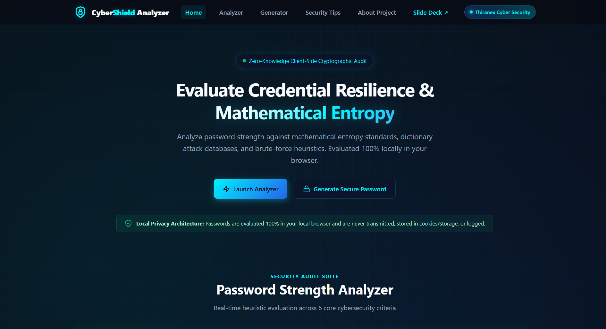
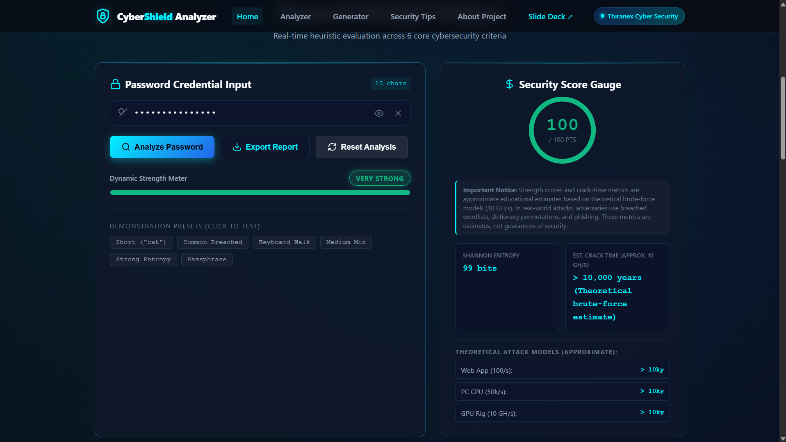

# 🔐 Password Strength Analyzer

## 1. Project Overview

The Password Strength Analyzer is a web-based application developed to evaluate the strength and security of user-entered passwords.

It analyzes passwords based on different security criteria and provides feedback to help users create stronger and more secure passwords.

## 2. Project Objectives

- To evaluate the strength of user-entered passwords.
- To identify weak, medium, and strong passwords.
- To encourage users to create secure passwords.
- To identify commonly used passwords.
- To provide suggestions for improving password security.
- To create a simple and user-friendly interface.

## 3. Features

- Password strength evaluation.
- Weak, Medium, and Strong classifications.
- Password security suggestions.
- Common password detection.
- Show/Hide password functionality.
- User-friendly interface.
- Responsive web design.

## 4. Technologies Used

- **HTML5:** Creates the structure of the application.
- **CSS3:** Provides styling and responsive design.
- **JavaScript:** Implements password analysis and interactive functionality.
- **Python:** Include this only if your application actually uses the Python backend.

## 5. Screenshots

Add screenshots of your application in this section.

Example:





## 6. Installation and Execution

### Prerequisites

- A web browser.
- Visual Studio Code (recommended).
- Live Server extension (optional).

### Steps

1. Clone the repository:

   ```bash
   git clone https://github.com/mohamedluqman-s/Password-Strength-Analyzer.git
   ```

2. Open the downloaded project folder in Visual Studio Code.

3. Open `index.html`.

4. Right-click and select **Open with Live Server**.

5. The application will open in your browser.

## 7. Live Demo

Try the Password Strength Analyzer:

https://mohamedluqman-s.github.io/Password-Strength-Analyzer/

## 8. Future Enhancements

- Add more advanced password security checks.
- Improve password analysis accuracy.
- Enhance user interface and accessibility.
- Add additional password security recommendations.
- Improve compatibility across different devices.

## Author

**Mohamed Luqman**

GitHub: https://github.com/mohamedluqman-s

---

*This project was developed as part of an internship project.*
